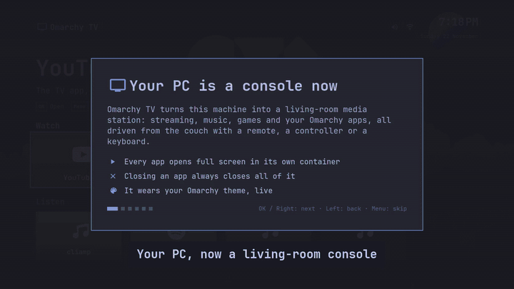

# Omarchy TV

**Turn your Omarchy PC into a living-room console.**

Plug it into the TV, pick up a controller, and the desktop gets out of the way: a
full-screen, couch-first media station for streaming, music, games, your Omarchy apps and
your AI agent, all driven by a remote, a gamepad or your voice. When you want the desktop
back, it's one button away.



<sub>Sped up 1.6×. **▶ Watch it with sound:** [docs/demo.mp4](docs/demo.mp4) (real time, original soundtrack)</sub>

- **Console-grade navigation.** Big tiles, a guide button, and every app full screen. Works
  with any controller, TV remote, phone remote app or keyboard.
- **Apps that behave.** Each app runs in its own container, so *Close* really closes it,
  *Force quit* unsticks anything, and background apps step aside or freeze.
- **Talk to it.** Hold a button and speak: Superwhisper transcribes, and your Omarchy
  agent (Claude, Codex, Pi, ...) answers or acts. "Put on some lofi" opens YouTube.
- **Type and point from the couch.** An on-screen keyboard pops up for text fields, and a
  stick-driven mouse turns on for apps that need one.
- **Unmistakably Omarchy.** Your theme, font and wallpaper, live. Omarchy's install menu,
  Omarchy Control and Game Vibes are all built in.
- **Sounds like one too.** Snappy interface sounds in three packs (Soft, Retro, Glass), or
  bring your own. Silence them any time.
- **Boots like a console.** Optionally open straight into the TV at login and when the PC
  wakes from sleep.

## Install

As an Omarchy extension (a shell plugin, with a TV button on your bar):

```
omarchy plugin add https://github.com/joetheshmoe/omarchy-tv --enable
```

Or from a checkout:

```
git clone https://github.com/joetheshmoe/omarchy-tv && cd omarchy-tv
./install.sh            # `omarchy-tv` on PATH, "Omarchy TV" in the app launcher
./install.sh --bind     # also Super+Alt+T
```

Then:

```
omarchy-tv              # start (or bring back) the TV
omarchy-tv stop         # close every TV app, then the TV
```

### Remove

```
omarchy-tv stop                        # if it's running
omarchy-tv autostart sync              # after turning off "open at login/after sleep", or:
systemctl --user disable --now omarchy-tv-autostart.service
omarchy plugin remove joetheshmoe.tv   # if installed as an extension
./install.sh --remove                  # if installed from a checkout (launcher, PATH link, Super+Alt+T)
```

Your settings, added apps and web-app logins stay in `~/.config/omarchy-tv` and
`~/.local/share/omarchy-tv`. Delete those folders (and `~/.cache/omarchy-tv`) to remove every
trace.

### Requirements

Omarchy TV requires Omarchy Control (`omarchy pkg add omarchy-control`; `install.sh` installs
it for you). Web apps need Chromium or Chrome, local media needs mpv, and voice needs
Superwhisper. The first launch walks you through it all.

For now the TV runs as a nested Hyprland session, full screen on your desktop. The same
config is written to drive a dedicated TV login session later.

## What you get

**Home**: a hero for the focused app, then rows: *Open now*, *Watch*, *Listen*, *Play*,
*Apps*, *System*. It uses your current Omarchy theme and wallpaper and recolors live when
you switch themes, including from TV Settings.

**Apps out of the box** (each row hides apps that aren't installed):
YouTube (the leanback `youtube.com/tv` app, made for D-pads), Netflix (picks Chrome for
Widevine), Twitch, YouTube Music, Spotify, Jellyfin and Kodi in TV mode, Steam Big
Picture, Omarchy's **Game Vibes**, local **Videos** and **Music** through mpv, a browser,
and every desktop app under *All apps*.

**Guide**: press Home inside an app to get a drawer over it with *Back to app*, *Home*,
*Switch to* (other open apps), *Close*, *Force quit*, volume and power. Press Home again
to go all the way Home.

**First run**: a short tutorial covers the remote, the guide, the keyboard, mouse and voice,
and making Home yours. It ends by offering to open the TV at login and after sleep.

**Settings**: sound output and volume, Bluetooth pairing (remotes, controllers,
headphones), Wi-Fi with an on-screen keyboard for passwords, UI size, overscan margin,
screensaver, Omarchy theme, pause-on-Home, hidden apps.

## Remote and controller

| Key | Home / menus | Inside an app |
|---|---|---|
| Arrows, OK (Enter) | move, open | the app's own |
| Back (Esc, Backspace, XF86Back) | back; on Home, return to the last app | the app's own |
| Home (XF86HomePage, tap Super) | top of Home | open the Guide; press again for Home |
| Menu | options for the focused app | the app's own |
| Volume keys | volume, with an on-screen display | same |
| Super+Q / XF86Close | | close the app |
| Super+Shift+Q | | force quit |
| Alt+Tab | | next open app |
| Super+K / Super+M / Super+A | keyboard / mouse mode / assistant | same |
| hold Super+T | talk | talk (types into the app) |
| Ctrl+Alt+Shift+Esc | always leaves the TV, even if the UI is gone | |

Binds match on the key's symbol, so phone remote apps, HDMI-CEC bridges and other
virtual keyboards work as well as USB and Bluetooth remotes. Scripts can drive the TV
too: `qs -p <folder>/shell ipc call tv open youtube` (also `home`, `back`, `close`,
`screen settings`, `volume 0.05`, `keyboard`, `pointer`, `talk`, `ask "question"`, `state`).

**Controllers**: `omarchy-tv-gamepad` turns any controller into a remote, with no extra
dependencies (it uses raw evdev and uinput):
- D-pad or stick: arrows. A: OK. B: Back (hold for Home).
- Guide: Home (hold for the assistant). X or Start: Menu. Y: play/pause.
- Select: mouse mode. L3: keyboard. R3: hold to talk.
- Bumpers: page up/down. Triggers: volume.

A held direction repeats about 8 times a second, the stick needs a firm push and moves
along one axis at a time, and duplicate presses from two pads are merged. Your desktop
gamepad mapper (`omarchy-gamepad.service`) is paused while the TV runs and started again
afterwards, so nothing is doubled. Controllers are picked up when you plug them in. While Steam or another app
marked `"input": "gamepad"` is in front, the bridge passes everything but Guide through,
so games never get doubled input.

**On the desktop**: while the TV window has focus, the desktop's Hyprland drops its own
binds (a submap) so Super, volume and Home reach the TV. Ctrl+Alt+Shift+F12 hands the
keyboard back to the desktop without leaving the TV.

## Typing, pointing and talking

**On-screen keyboard.** `tv-ime` (a tiny C program, built on first start into
`~/.cache/omarchy-tv`) registers as the session's input method, so the compositor tells the
TV whenever an app focuses a text field. The keyboard then slides up by itself: password
fields get a hidden field, and nothing pops up for controller games. Send puts the text into
the field through the input method (any Unicode, no fake key presses). Send + Enter also
submits. Apps without text-input support get typed into instead. You can open it any time
with **L3** on a controller, **Super+K**, or *Keyboard* in the guide. Typing on a real
keyboard works too, and Enter sends. Web apps run with `--enable-wayland-ime`, and the
desktop's fcitx variables are unset for TV apps so they talk to the TV's input method.

**Mouse mode.** Apps marked `"input": "pointer"` (Browser) turn it on by themselves.
**Select** on a controller or **Super+M** toggles it for any app.
- Controller: left stick moves the pointer (with acceleration), right stick scrolls, A
  clicks, X right-clicks.
- Plain remote: arrows move (Shift for fine steps), OK clicks, Menu right-clicks, Page
  up/down scrolls, Back leaves.

The pointer is a virtual mouse owned by the controller bridge, so it is the same in nested
and real sessions.

**Voice (Superwhisper).** Hold **R3**, or hold **Super+T**, to talk; tap it to start and
again to stop.
- Inside an app, what you say is typed into it.
- With the keyboard open, it goes into the keyboard's field. The keyboard also has a
  *Speak* key.
- On Home or in the assistant, it becomes a question.

The TV records the mic itself and hands the clip to `superwhisper transcribe`. That uses
your Superwhisper mode, language and vocabulary, never auto-pastes onto the desktop, and
changes none of its settings.

**Assistant.** Hold **Guide**, press **Super+A**, or pick the *Ask* tile, then talk or
type. Your Omarchy agent answers in large text: the `omarchy default agent` if it can run
headless, otherwise the first installed of Claude Code, Codex or OpenCode. It runs
read-only in its own folder.

The agent can't do anything on its own. To change the TV it ends its answer with a `TV:`
line, and the TV only carries out a fixed list of commands: open an app, search YouTube,
close, home, volume, settings. "Put on some lofi" opens YouTube on a lofi search. The
*Agent* tile, or *Open Claude* in the assistant, runs the full Omarchy agent fullscreen in
foot, with the keyboard and voice available.

## Apps are containers

Each app runs in its own systemd scope, `omarchy-tv-app-<id>-<n>.scope`, in
`omarchy-tv.slice`:

- **Closing really closes.** *Close* asks the app's windows to close, then sends SIGTERM to
  the whole cgroup, then SIGKILL. Nothing stays behind (helpers, crash handlers,
  steamwebhelper). *Force quit* kills it straight away. In tests a web app closes in about
  0.6 s and force-quits in about 0.4 s.
- **Apps that leave the scope are still tracked.** Chromium moves its browser process
  into a scope of its own, so each launch also records the app's root PID. The
  compositor walks a window's process ancestry to that PID, and Close and Force quit act
  on whichever scope the PID is in now.
- **Separate profiles.** Each web app gets its own Chromium profile in
  `~/.local/share/omarchy-tv/profiles/`, so TV logins stay on the TV and never hand off
  to the desktop browser (or open a window on the desktop). Share one profile between
  apps with `"profile"`.
- **Background apps step back.** An app you leave for Home drops to CPU/IO weight 20, and
  with `"freeze": true` (Game Vibes, emulators) it is frozen in place by the cgroup
  freezer and thawed when you return. Media apps are paused by MPRIS when you go Home.
  Players are matched to the app by PID, so music on the desktop is left alone.
- **One fullscreen workspace per app.** Windows land on `tv-<id>` fullscreen, dialogs
  float centred, and when an app quits or crashes you're back on Home instead of an empty
  screen.
- Per-app `env`, `scale` (Chromium device scale, or Qt/GTK/Electron scaling for desktop
  apps), `userAgent` and `memoryHigh` (a soft memory cap on the scope).

## Performance

- Compositor: no blur, shadows, borders, gaps or rounding. Short fades only. Direct
  scanout and VRR for fullscreen apps, tearing for games that ask for it, and apps on
  hidden workspaces throttled to 5 fps.
- Going Home switches to an empty workspace, so the compositor stops drawing the app
  underneath.
- Shell: one Quickshell process. While an app is in front none of its surfaces are
  mapped. Screens other than Home are created when opened and freed when you leave.
  The clock wakes once a minute, the wallpaper is decoded once at screen size, and there
  are no shader effects. Measured: about 1 ms of CPU per second idle on Home, and the
  same with an app in front.
- Shell crashes restart within a second (`omarchy-tv-shell`). Global keys go
  compositor → shell as Hyprland global shortcuts, so no process is spawned per key
  press.
- Chromium gets Wayland, VA-API video decode, GPU rasterization and zero-copy. mpv gets
  `hwdec=auto-safe` and `gpu-next`.

## Built on Omarchy

The live theme palette (`colors.toml`) and current background, Omarchy theme switching,
Game Vibes, `omarchy system reboot/shutdown/lock`, the app library (desktop entries),
the Omarchy-style launch-or-focus for running apps, and global shortcuts as in Omarchy's
own shell. Your Hyprland `input.lua` (keyboard layout) is reused. Nothing under
`/usr/share/omarchy` is modified.

## Interface sounds

Moving, OK, Back, opening and closing apps, the guide, typing and notifications each have a
short sound. *Settings › Sound › Sound pack* picks **Soft** (default), **Retro** (8-bit),
**Glass**, or **Off**, and *Interface volume* sets how loud they are. Changing either plays a
preview.

All three packs are synthesized by `tools/make-sounds.py`, so there are no samples or
licences involved. For your own pack, make `~/.config/omarchy-tv/sounds/<name>/` with any of
`move.wav select.wav back.wav open.wav close.wav toggle.wav guide.wav type.wav error.wav
notify.wav`. It appears in the list, and any sound you leave out falls back to Soft.

## Make it yours

**Reorder everything.** Press Menu on any tile:
- *Move* lifts the tile. Left and Right carry it along its row, Up and Down carry it into
  the next row, and OK drops it.
- *Move this row* shifts the whole row up or down.

The order is saved in `settings.json` (`layout`). Apps you install later still appear, at
the end of their row. *Settings › Home* shows or hides whole rows, brings back hidden apps
and resets the layout.

**Add and remove apps.** Menu › *Add to Home…*, the *Add to Home* tile, or *Settings ›
Home*:
- an installed app (anything in the launcher)
- a website (its own browser profile, mouse mode on)
- a terminal program (full screen in a couch-sized terminal)
- any command

Then pick a row, or make a new one. Added apps go into `~/.config/omarchy-tv/apps.json`.
*Remove* deletes your own entries and hides built-in ones.

**Omarchy's install menu.** The *Install* tile, or *Settings › Advanced › Install /
Remove / Update*, shows Omarchy's own menu, read from the same files as Super+Alt+Space,
including your `~/.config/omarchy/extensions/omarchy-menu.jsonc`. It uses Omarchy's icons
and marks what is already installed. Actions run inside the TV: small shims for `uwsm-app`
and `xdg-terminal-exec` (`shim/`) make their terminals open fullscreen in the TV instead of
on the desktop. Home rechecks what is installed when an install finishes.

**Swap the agent.** *Settings › Assistant*:
- *The TV assistant answers with* chooses which agent answers quick questions, or follows
  Omarchy's default. Agents that can answer in one go: Claude, Codex, OpenCode, Crush,
  Copilot, Cursor CLI, Qwen, Gemini, Pi, Amp.
- *Omarchy's default agent* lists every installed harness from Omarchy's menu and sets the
  default system-wide (`omarchy-default-agent`). The *Agent* tile opens that one, full
  screen.

**Music.** cliamp is on Home in Listen: radio, local files, and Spotify or YouTube Music
through its providers. It runs full screen in a large terminal. *Settings › Apps › Play
music files with* switches the Music folder between mpv and cliamp.

**Omarchy Control (required).** Omarchy TV needs Omarchy Control: `install.sh` installs it
if it is missing, and `omarchy-tv` won't start without it. It is the TV's advanced
settings: open it as a tile, or jump to a page from *Settings › Advanced* (Appearance,
Displays, Sound, Network, Input, Power, Apps, Desktop, Accounts, System, Advanced). It runs
full screen at 1.5× with mouse mode on.

## Customising

- `~/.config/omarchy-tv/apps.json`: your apps, same shape as `apps/catalog.json`. It
  reloads live. Types: `web`, `native`, `steam`, `media`, `vibes`. `needs` hides an entry
  unless its commands exist.
- `~/.config/omarchy-tv/settings.json`: written by Settings.
- `~/.config/omarchy-tv/hyprland.lua`: extra Hyprland config for the TV session (loaded
  last).

## Demo

`tools/demo.sh` records the demo above. It drives a hidden session with scripted presses,
records it with wf-recorder and captions it with ffmpeg. The soundtrack is built by
`tools/demo-audio.py`: an original synthesized synthwave bed, plus every interface sound the
TV played, placed at the moment it played (the shell logs them in demo mode), with swooshes
on caption changes. The demo session itself is silent, and your desktop audio is never
recorded.

## Testing without seeing it

```
OMARCHY_TV_TEST=1 omarchy-tv test     # hidden session, 1080p headless output
OMARCHY_TV_TEST=1 omarchy-tv key Down Right Return
OMARCHY_TV_TEST=1 omarchy-tv shot /tmp/tv.png
OMARCHY_TV_TEST=1 omarchy-tv stop
```

The nested window sits on a hidden special workspace and everything renders to a
headless output, so screenshots and key injection work while your screen stays as it is.

## Layout

```
bin/omarchy-tv          session: start/stop/status/test/shot/key, desktop passthrough
bin/omarchy-tv-app      app containers: run/close/kill/fg/bg/list
bin/omarchy-tv-shell    runs the Quickshell UI and restarts it if it crashes
bin/omarchy-tv-gamepad  controller to remote and mouse bridge (evdev to uinput)
bin/omarchy-tv-voice    mic recording, transcribed by Superwhisper
bin/omarchy-tv-ask      one question to your Omarchy agent
bin/omarchy-tv-build    builds helpers/tv-ime.c (input method) into ~/.cache/omarchy-tv
bin/omarchy-tv-menu     Omarchy's menu (Install, Remove, ...) as JSON, and runs its rows
shim/                   uwsm-app and xdg-terminal-exec that keep launches inside the TV
helpers/                tv-ime source and the protocol it speaks
hypr/hyprland.lua       the TV compositor config
shell/                  Quickshell UI (core/ state and theme, ui/ screens)
apps/catalog.json       built-in apps
config/                 mpv remote bindings, example apps.json
```

## Not done yet

- A real TV login session (greetd/UWSM entry) instead of nested. The Hyprland config is
  already written for it.
- HDMI-CEC: map `cec-client` output to keys, or call the IPC above.
- DRM services need Google Chrome (`omarchy install browser chrome`). Chromium has no
  Widevine.
